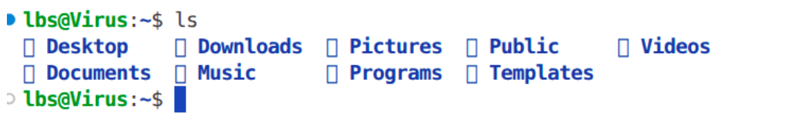
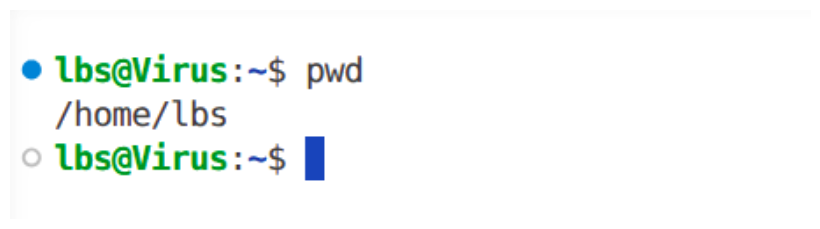
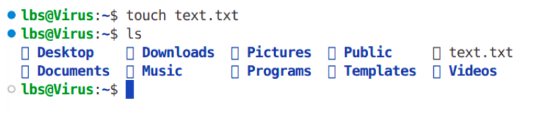
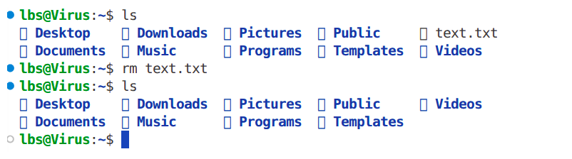
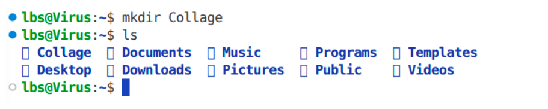
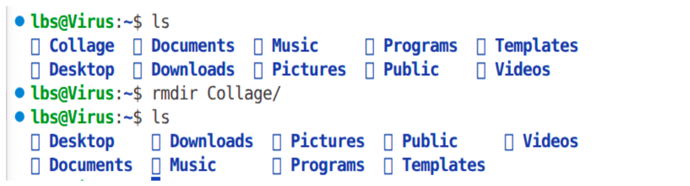
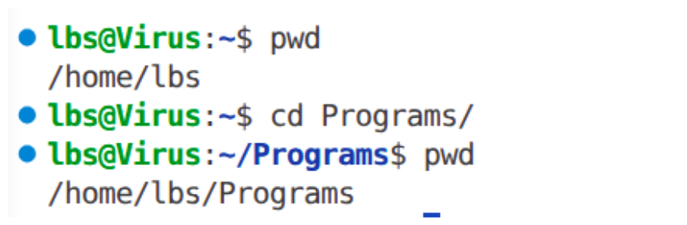

<h1> Assigment </h1>
<h2> Complete a short terminal-navigation practice sheet. </h2>
<ul>
  <li> 
      <h3> 
 ls (List) 
  
       
      
 This command is use to print current directory files and folders.

  </li>
  <li> 
      <h3> 
 pwd (Print Working Directory) 
  
       
      
 This command prints the absolute path of current location in file system.

  </li>
  <li> 
      <h3> 
 touch 
  
       
      
 This command creates an new empty file.

  </li>
  <li> 
      <h3> 
 rm 
 (Remove)  
      
      
 This command deletes a file from file system.

  </li>
  <li> 
      <h3> 
 mkdir (Make Directory)
  
      
      
 This command creates a new folder in the file system.

  </li>
  <li> 
      <h3> 
 rmdir (Remove Directory) 
  
      
      
 This command deletes empty folder from file system.

  </li>
  <li> 
      <h3> 
 cd (Change Directory) 
  
      
      
 This command changes the current working directory

  </li>
</ul>
